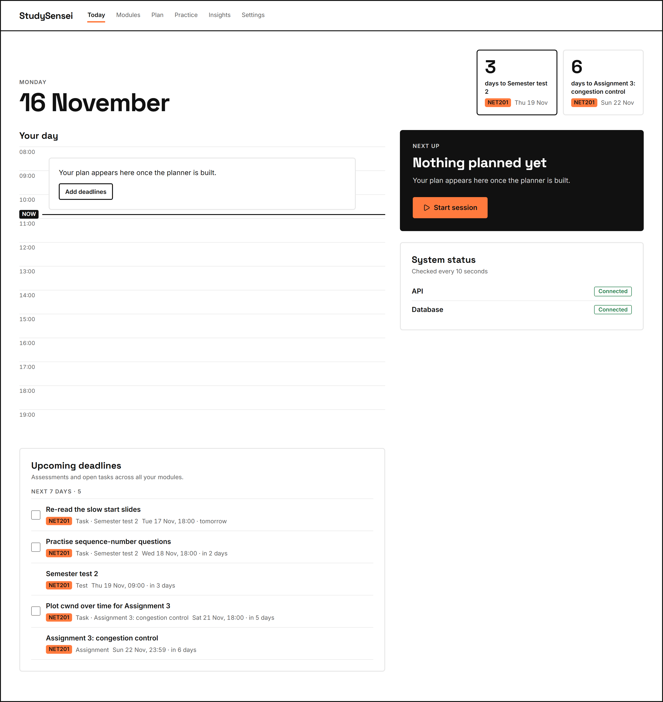
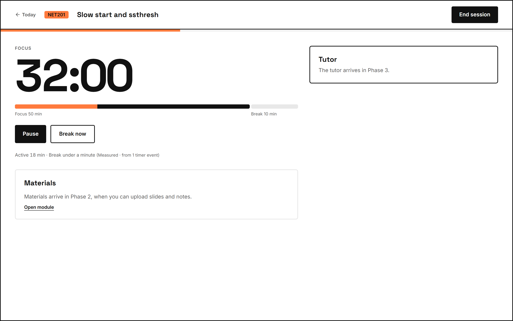
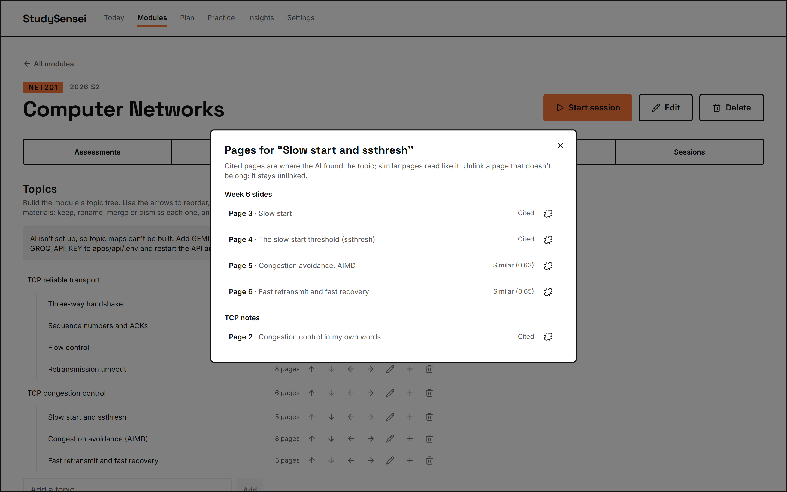
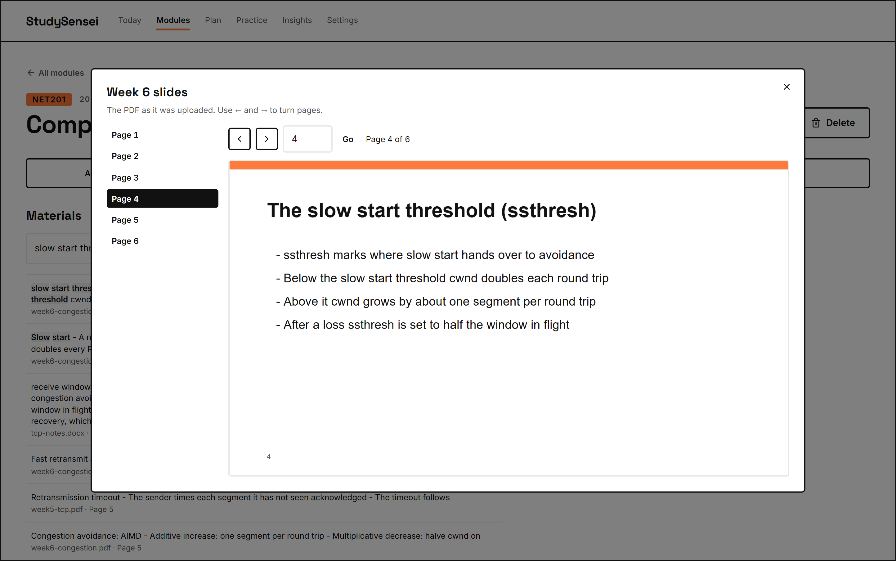
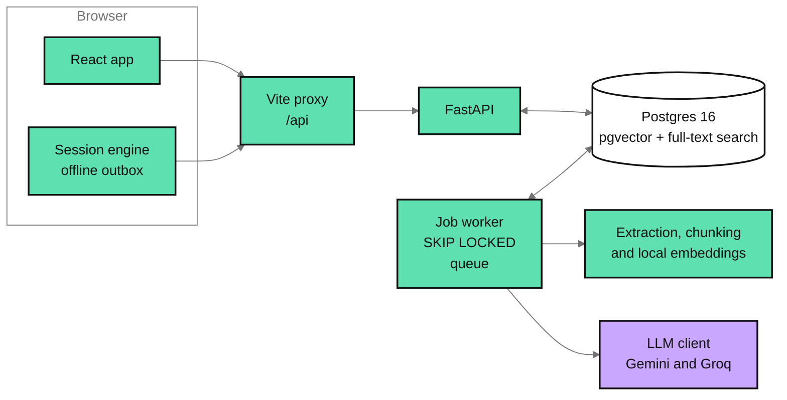

<p align="center">
  <picture>
    <source media="(prefers-color-scheme: dark)" srcset="docs/assets/banner-dark.png" />
    
  </picture>
</p>

<p align="center">
StudySensei organises your own course material into a topic map you control, finds the exact page for any question
across your slides, notes and past papers, and records every study session with a timer that survives reloads, sleep
and lost connections.
</p>

<p align="center">
Next: a tutor that answers with citations into your pages, and a planner that tells you what to study next, and why.
</p>

<p align="center">
  <a href="https://github.com/Josh-Heath123/StudySensei/actions/workflows/ci.yml"></a>
  <a href="LICENSE"></a>
  <a href="docs/ROADMAP.md"></a>
</p>



## What it does

| Capability | For a student | How |
| --- | --- | --- |
| Materials to topics | Upload slides and notes; get a topic tree you review (keep, rename, merge, dismiss), each topic linked to its pages | Per-material AI proposals, one anchored merge applied by code, local similarity links ([0006](docs/decisions/0006-topic-maps.md), [0009](docs/decisions/0009-topic-review.md)) |
| Search to the exact page | Ask a question in your own words and land on the page that answers it | Page-bound chunks, local embeddings and full-text search fused with RRF ([0005](docs/decisions/0005-chunking-and-search.md)) |
| Material viewer | Open any result or linked page at that page | pdf.js, loaded on first use; other formats show their text |
| Study sessions | Focus and break timer, a 20-second reflection, and history per module | An append-only event log replayed by one pure reducer ([0003](docs/decisions/0003-session-event-log.md)) |
| Deadlines on Today | Countdowns to the next assessments and every open task, across modules | Assessments and tasks per module, in your time zone |
| Free AI, usage shown | See which free models are set up, today's usage against each budget, and test the keys | Gemini and Groq free tiers behind one adapter, with budgets and pacing ([0002](docs/decisions/0002-free-ai-providers.md)) |

## Screenshots

Taken from the running app by `npm run screenshots`, with synthetic demo data (an invented networks module).

| | |
| --- | --- |
|  **Today:** countdowns and upcoming deadlines |  **Session:** the focus timer, 18 minutes in |
|  **Topics:** a topic's cited and similar pages |  **Viewer:** a search for "slow start threshold", opened at the slide |

## Engineering highlights

- **AI can't overwrite you.** AI output is saved only after it passes a schema, and the merge only adds to your tree:
  dismissed names are remembered and blocked in code ([0006](docs/decisions/0006-topic-maps.md),
  [0009](docs/decisions/0009-topic-review.md)).
- **Bounded free AI.** Requests are routed by role across Gemini and Groq, with daily budgets, pacing and at most 4
  calls per material. The first real topic map took 155 calls; after the fix a rebuild took 15
  ([0007](docs/decisions/0007-bounded-topic-extraction.md), [0008](docs/decisions/0008-busy-models-and-refusals.md)).
- **Retrieval you can cite.** Chunks never cross a page, embeddings run locally, and full-text and vector search are
  fused with RRF. On 15 hand-written queries over a real module, an acceptable page is in the top 3 for all 15
  (MRR 0.900) ([0005](docs/decisions/0005-chunking-and-search.md), [evals](apps/api/evals/README.md)).
- **A timer you can trust.** Sessions are an append-only event log with one pure reducer and idempotent offline
  batches; pytest and Vitest run the same [timeline fixtures](fixtures/session-timelines.json)
  ([0003](docs/decisions/0003-session-event-log.md)).
- **Isolation from day one.** Every user-owned table carries `user_id` with composite foreign keys, every endpoint has a
  cross-user HTTP test, and a [schema guard](apps/api/tests/test_schema_guards.py) fails any new table without it
  ([ARCHITECTURE](docs/ARCHITECTURE.md)).
- **The merge gate.** `main` takes only pull requests that pass one required check, with a secret scan and a licence
  check on every PR and signed commits required since 18 Nov 2026. CI ran in 1.5 minutes on the latest PR; the suite
  is 603 API tests, 304 web tests and 3 end-to-end tests ([CONTRIBUTING](CONTRIBUTING.md)).

## Architecture



Lilac: AI proposes. Mint: ordinary code decides. White: storage.

| Layer | Technology |
| --- | --- |
| Web | React 19, TypeScript, Vite, Tailwind, TanStack Query, pdf.js |
| API | Python 3.12, FastAPI, Pydantic, SQLAlchemy 2 (async), Alembic |
| Data | Postgres 16 with pgvector and full-text search |
| Jobs | A Postgres queue (`FOR UPDATE SKIP LOCKED`) and a worker process |
| Search | fastembed with BAAI/bge-small-en-v1.5, run locally |
| AI | Gemini and Groq free tiers through one OpenAI-compatible client |
| Tests and CI | pytest, Vitest, Playwright, GitHub Actions |

## Status

| Phase | Scope | Status |
| --- | --- | --- |
| 0 | Reset and foundations | Done |
| 1 | Modules, assessments and study sessions | Done; the real-use check (three study days) is pending |
| 2 | Materials and topic maps | Done; search finds a slide in the top 3 for 11 of 15 queries against a target of 12 |
| 3 | Grounded tutor and voice | Next |
| 4 | Planner | Planned |
| 5 | Practice and mastery | Planned |
| 6 | Past-paper intelligence | Planned |
| 7 | Camera companion (opt-in) | Planned; spike S1's measurement page is built, awaiting runs |
| 8 | Profile and insights | Planned |
| 9 | Beta readiness | Planned |

What each phase delivered is in the [CHANGELOG](CHANGELOG.md); Phase 2 is tagged
[v0.2.0](https://github.com/Josh-Heath123/StudySensei/releases/tag/v0.2.0).

## Run it locally

You need Git, [uv](https://docs.astral.sh/uv/), Node.js 22 and Docker Desktop (running).

```bash
git clone https://github.com/Josh-Heath123/StudySensei.git && cd StudySensei
npm install && uv sync --directory apps/api
npm run dev
```

Then open http://localhost:5173. AI features (topic maps) need a free Gemini or Groq key in `apps/api/.env`;
everything else, search included, runs without one.

<details>
<summary>Full setup, ports and checks</summary>

- `npm run dev` starts Postgres in Docker (port 5433), applies migrations, creates the local user, and runs the web app
  on :5173, the API on :8000 (docs at http://localhost:8000/docs) and the job worker. The web app reaches the API
  through Vite at `/api`.
- Copy `apps/api/.env.example` to `apps/api/.env` to add `GEMINI_API_KEY` or `GROQ_API_KEY`, or to change defaults.
  Restart `npm run dev` after editing it.
- The Today page's **System status** card should show **Connected** for both rows.
- `npm run check` runs everything CI runs except end-to-end: ruff, prettier, eslint, mypy, tsc, pytest (real Postgres)
  and Vitest, in about a minute. `npm run e2e` runs Playwright on its own ports and database.
- The first indexing run downloads the embedding model (about 65 MB) to `data/models`.

</details>

## Documentation

| Doc | What you'll find |
| --- | --- |
| [Documentation hub](docs/README.md) | Where to start, and every doc in reading order |
| [Product](docs/PRODUCT.md) | What StudySensei is for and what it deliberately doesn't do |
| [Architecture](docs/ARCHITECTURE.md) | The API contract, data model, AI client, search and CI |
| [Design](docs/DESIGN.md) | The "Planner" design system |
| [Decisions](docs/decisions/README.md) | The architecture decision records |
| [Roadmap](docs/ROADMAP.md) and [Progress](docs/PROGRESS.md) | The plan, and the session log of what was done and measured |
| [Evals](apps/api/evals/README.md) | Search, linking and topic-extraction evals with their results |
| [Contributing](CONTRIBUTING.md) | The merge gate and branch rulesets |

## How it's built

Joshua Heath directs StudySensei and makes every product and design decision. Implementation is AI-assisted under a
documented process: written task specifications, decision records, evals, and CI-gated pull requests that he reviews
and merges (with signed commits since 18 Nov 2026). The full record is in [docs/AUTHORSHIP.md](docs/AUTHORSHIP.md).

## Ownership and licence

StudySensei is a personal project owned by Joshua Heath. All rights reserved: see [LICENSE](LICENSE).

- [docs/AUTHORSHIP.md](docs/AUTHORSHIP.md): who makes it and how, as a dated record.
- [THIRD_PARTY_NOTICES.md](THIRD_PARTY_NOTICES.md): the third-party components it uses and their licences (generated
  by `npm run licenses`).
